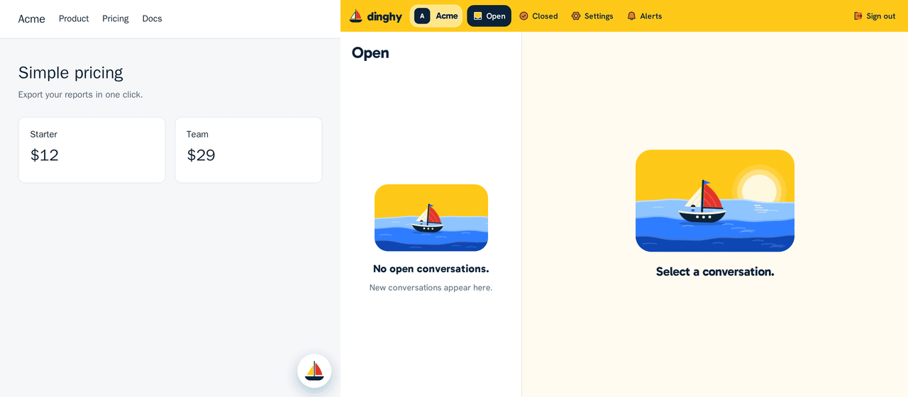

# Dinghy

[](https://github.com/dinghy-chat/dinghy/actions/workflows/ci.yml)

A small open-source live support chat that you can run on one small server.



On a new Linux server:

```sh
git clone -b v0.3.6 https://github.com/dinghy-chat/dinghy.git
cd dinghy
sudo ./install.sh
```

The installer asks a few questions, installs Docker if it is missing, gets an HTTPS certificate and prints your password and the tag for your site. [The docs](docs/README.md) have the next steps.

It has text and images in both directions, verified users, several operators, web push and email alerts, and export and import. [`NON_GOALS.md`](NON_GOALS.md) lists what it does not do.

One Hetzner CX23 ran the full install with 5,000 open streams in under 600 MB. [The measurements](docs/measurements.md) have the numbers and their limits.

## Self-hosted or cloud

The code is the same. A paid cloud plan is planned, and it is not open yet.

|                      | Self-hosted    | Cloud                                                     |
| -------------------- | -------------- | --------------------------------------------------------- |
| Runs on              | Your server    | Ours                                                      |
| Updates and backups  | You run them   | We run them                                               |
| Third-party accounts | None needed    | None for you                                              |
| Your data            | On your server | Exports to a file that imports into a self-hosted install |

## Docs

- [Start here](docs/README.md)
- [Self-hosting](docs/self-hosting.md), including settings, backups, restore and upgrades
- [Add the chat to your website](docs/add-to-your-site.md)
- [Use the operator app](docs/operator-guide.md)
- [Troubleshooting](docs/troubleshooting.md)
- [Run on Coolify or Dokploy](docs/deploy-coolify-dokploy.md), not tested yet
- [Changelog](CHANGELOG.md)
- [Security](SECURITY.md)

## Development

You need Bun, Node 24 and Docker.

```sh
bun install
bun run dev
```

That starts Postgres, Valkey and an S3-compatible store in Docker, and Dinghy at <http://localhost:3000>, with a test site for the widget at <http://localhost:3001>. [`CONTRIBUTING.md`](CONTRIBUTING.md) has the checks, the code layout and the contributor license agreement. Everyone who takes part follows the [code of conduct](CODE_OF_CONDUCT.md).

## License

Dinghy is open core. [`LICENSE-NOTICE.md`](LICENSE-NOTICE.md) explains the split.

- The server, the operator app and everything else outside the two folders below use the AGPL 3.0. See `LICENSE`.
- The widget (`packages/widget`) uses the MIT license, so any site can embed it. See `packages/widget/LICENSE`.
- `ee/` holds the billing, signup, plan limits and image retention that only Dinghy Cloud runs, under a source-available license. See `ee/LICENSE`. A self-hosted install has every product feature. The image ships `ee/`, and a self-hosted install never turns it on: the code stays inactive unless the cloud's settings are set, and the license allows running it that way.
