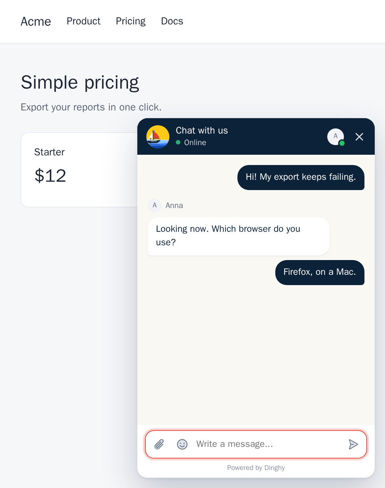

# Add the chat to your website



## Add the tag

The installer prints your tag. You can also copy it from **Install code** in **Settings > Install** in the operator app. It looks like this:

```html
<script src="https://chat.example.com/widget/loader.js" data-key="wk_your_public_key" async></script>
```

Put it before the closing `</body>` tag, on every page that should have the chat.

Then add your website under **Allowed sites** in **Settings > Install**, with one origin on each line. An origin has the scheme and the host and no path, such as `https://www.example.com`. The chat does not work on a site that is not on this list. This includes `www` and the bare domain, which are two different origins.

The tag is safe to publish. The key in it only names your workspace. The tag loads a small script of under 4 KB, and the full chat loads only when a visitor opens it or comes back to a chat.

Put the chat on your own site, not on a page served from the same address as Dinghy. The chat does not work there, because a browser does not send an origin for a request to its own address.

## Change how it looks

The easiest way needs no code: **Settings > Appearance** in the operator app sets the colors, the side, the theme, the chat button, the corners, the boat, the words, when to ask for an email and the "Powered by Dinghy" line. The [operator guide](operator-guide.md#change-the-widget) explains it. Pages of your site that open after a save show the change within 5 minutes, and a page already open keeps the look it loaded with.

You can also set the look in the tag. These attributes win over the saved settings, and `Dinghy.configure()` wins too:

| Attribute | Value | Effect |
|---|---|---|
| `data-primary` | A full hex color, such as `#112233` | The color of the header, the visitor's messages and the boat's hull |
| `data-accent` | A full hex color | The color of the buttons and the boat's sail |
| `data-mascot` | `false` or `true` | Hides or shows the boat in the open chat. Each state still shows its text |
| `data-launcher` | `bubble`, `label`, `square`, `boat` or `hidden` | The chat button. `label` shows the chat's title beside the icon, and `hidden` lets you open the chat from your own button |
| `data-position` | `left` or `right` | The corner for the button and the chat |
| `data-offset-x` | Pixels, such as `24` | The distance from the side of the window. The default is `16` |
| `data-offset-y` | Pixels, such as `80` | The distance from the bottom of the window. The default is `16` |
| `data-branding` | `false` or `true` | Hides or shows the "Powered by Dinghy" line |

A color in any other form, such as `red` or `#123`, is ignored. So is an offset that is not a whole number of 0 or more.

So the order is: the tag's attributes and `Dinghy.configure()`, then the saved settings, then Dinghy's defaults. The loader asks your Dinghy server for the saved settings and draws the chat button once they arrive, so the button never changes shape. If your server cannot answer, the button draws from the tag and the defaults. If the workspace's widget is off, such as for a suspended workspace, nothing shows.

To match your fonts and corners, set these CSS variables on the `dinghy-chat` element. They win over the corners in the saved settings, and each one falls back to them:

```css
dinghy-chat {
  --dinghy-font: "Inter", system-ui, sans-serif; /* the chat's text */
  --dinghy-radius: 12px; /* the chat panel's corners, 16px by default */
  --dinghy-launcher-radius: 12px; /* the square and boat buttons' corners, 16px by default. The bubble is round */
}
```

## Control it from your page

The tag adds a `Dinghy` object to the page:

| Call | What it does |
|---|---|
| `Dinghy.open()` | Opens the chat |
| `Dinghy.open({ message })` | Opens the chat with `message` in the message box. The visitor still sends it |
| `Dinghy.close()`, `Dinghy.toggle()` | Closes the chat, or opens it if it is closed |
| `Dinghy.show()`, `Dinghy.hide()` | Shows or hides the chat button. `data-launcher="hidden"` only sets how it starts |
| `Dinghy.identify(token)`, `Dinghy.reset()` | Signs a user in and out. See [Show who is chatting](#show-who-is-chatting) |
| `Dinghy.setContext(data)` | Tells operators about the page, such as a plan or a cart. See below |
| `Dinghy.configure(options)` | Changes the colors, the side, the offsets and the z-index now |
| `Dinghy.on(event, callback)` | Calls `callback` on each event, and returns a function that stops it |
| `Dinghy.state` | `{ ready, open, unread }`, read only |

### Use your own button

Hide the chat's button with `data-launcher="hidden"`, then open the chat from yours:

```html
<button onclick="Dinghy.open()">Chat with us</button>
```

To start the visitor's message for them, pass it. It waits in the message box, and nothing is sent until the visitor sends it:

```html
<button onclick="Dinghy.open({ message: 'I have a question about my invoice' })">
  Ask about billing
</button>
```

### Listen to events

```js
// Show your own unread count. It runs at once with the current count, then on each change.
const stop = Dinghy.on("unread", (count) => {
  document.querySelector("#help-badge").textContent = count || "";
});
stop(); // Stops listening.

Dinghy.on("open", () => analytics.track("chat opened"));
Dinghy.on("message:sent", ({ body }) => analytics.track("chat message sent"));
```

| Event | When | Callback gets |
|---|---|---|
| `ready` | The full chat has loaded | Nothing |
| `open`, `close` | The chat opens or closes | Nothing |
| `unread` | The unread count changes, and once at once | The count |
| `message:sent` | The visitor's message reached Dinghy | `{ body }`, with `body` null for an image |
| `message:received` | A reply arrives while the page is open | `{ body }`, with `body` null for an image |
| `conversation:started` | The visitor's message started a new conversation | Nothing |

A callback that throws does not stop the chat or the other callbacks. The browser reports its error.

### Tell operators about the page

`setContext` sends facts from your page that help operators answer, such as the visitor's plan or what is in their cart:

```js
Dinghy.setContext({ plan: "pro", cartTotal: 129.5, trial: false });
```

It takes up to 20 keys of up to 40 characters. Each value is a string of up to 200 characters, a number, `true`, `false` or `null`. The widget drops anything else, and cuts a longer string. Each call replaces the last one.

The widget sends it only for a visitor who has chatted: after their first message, and again on each later call. Operators see it next to the conversation, marked as sent by the page and not checked. Anyone can change what their own browser sends, so do not trust it for anything that matters. For facts you can vouch for, sign them in the `attributes` of [the identity token](#show-who-is-chatting).

### Change the look while the page runs

```js
Dinghy.configure({ accent: "#e5352b", position: "left", offsetX: 24, offsetY: 80, zIndex: 1000 });
```

It takes the same values as the tag's attributes, and ignores one that is not valid. `zIndex` is a whole number of 0 or more, and it is `2147483000` by default.

### Call it before it loads

The script loads with `async`, so `Dinghy` may not exist yet when your own script runs. To call it early, queue the calls before the tag. Every call works this way, `on` too:

```html
<script>
  window.Dinghy = {
    q: [
      ["on", "unread", (count) => console.log("unread", count)],
      ["open", { message: "Hello" }],
    ],
  };
</script>
<script src="https://chat.example.com/widget/loader.js" data-key="wk_your_public_key" async></script>
```

### Install it from npm

In an app with a bundler, the `@dinghy-chat/widget` package adds the tag for you and gives typed calls:

```sh
npm install @dinghy-chat/widget
```

```ts
import { init } from "@dinghy-chat/widget";

const dinghy = init({
  url: "https://chat.example.com",
  key: "wk_your_public_key",
  accent: "#e5352b",
  position: "left",
  launcher: false, // the same as data-launcher="hidden"
});

dinghy.on("unread", (count) => setBadge(count));
dinghy.open({ message: "I need help with my order" });
```

`init` adds the tag once, however often it runs, and returns the same `Dinghy` object. Calls made before the script loads wait for it. It takes `url`, `key` and the options of the tag: `primary`, `accent`, `mascot`, `branding`, `launcher`, `position`, `offsetX`, `offsetY` and `zIndex`. The package also exports the types, such as `DinghyApi` and `DinghyEvents`.

### Ask a coding agent to install it

Paste this prompt into your coding agent, such as Claude Code, with your own address and key:

```text
Add the Dinghy live chat to this app. My Dinghy server is https://chat.example.com and my
public key is wk_your_public_key.

1. Load the widget on every page where visitors may need help. In a plain site, add
   <script src="https://chat.example.com/widget/loader.js" data-key="wk_your_public_key" async></script>
   before </body>. In an app with a bundler, install @dinghy-chat/widget and call
   init({ url, key }) once at startup, in the browser only.
2. If the app has a Content Security Policy, allow https://chat.example.com in script-src,
   connect-src and img-src.
3. If users sign in, add a server route that signs an HS256 JWT with the workspace's signing
   secret from an environment variable (never in client code), with sub = the user's ID,
   aud = the public key, iat, exp at most 24 hours later, and the optional name, email and
   attributes. Call Dinghy.identify(async () => fetch that route's token) after sign-in, and
   Dinghy.reset() at sign-out.
4. Where it helps support, call Dinghy.setContext({ ... }) with a few facts such as the plan.
5. Read https://dinghy.chat/docs/add-to-your-site and https://dinghy.chat/llms.txt for the
   full API, and do not add anything else.
```

## Show who is chatting

With no more work, a visitor is anonymous. Their chat stays in that browser, and they can leave an email in the chat so you can reply if they leave. A browser that does not come back for a year starts a new chat.

If your site has logins, you can tell Dinghy who the user is. Their chat then follows them to every device, and operators see their name, email, your user ID and any custom attributes you send. An anonymous chat from before the sign-in does not merge into it, and the widget shows the user's own chat.

Your server signs a short token with the workspace's signing secret, and your page passes it to the widget.

**1. On your server,** sign the token. Copy the secret from **Identify signed-in users (optional)** in **Settings > Install**, and keep it on your server only. This example uses the `jose` package for Node:

```js
import { SignJWT } from "jose";

const secret = new TextEncoder().encode(process.env.DINGHY_SIGNING_SECRET);

export function dinghyToken(user) {
  return new SignJWT({
    name: user.name,
    email: user.email,
    attributes: { plan: user.plan, account: `https://admin.example.com/users/${user.id}` },
  })
    .setProtectedHeader({ alg: "HS256" })
    .setAudience("wk_your_public_key")
    .setSubject(String(user.id))
    .setIssuedAt()
    .setExpirationTime("1h")
    .sign(secret);
}
```

Any JWT library works, in any language. The token must have these fields:

| Field | Value |
|---|---|
| Algorithm | `HS256` |
| `aud` | Your public key from the tag |
| `sub` | Your user's ID, up to 255 characters |
| `iat` and `exp` | The issue time and the expiry, at most 24 hours apart |
| `name` | Optional. The name operators see, on one line, up to 100 characters. Anything else is dropped |
| `email` | Optional. One address, which operators see. Anything else, such as a list, is dropped |
| `attributes` | Optional. Custom attributes that operators see, such as a plan, up to 2 KB of JSON. A value that starts with `https://` or `http://` shows as a link |

**2. On your page,** pass a function that asks your server for a token. The widget calls it again when a token expires, so a tab that stays open keeps working:

```js
Dinghy.identify(async () => {
  const response = await fetch("/api/dinghy-token", { method: "POST" });
  return response.text();
});
```

You can also pass the token as a string, but a string cannot renew itself. Call `identify` on each page load, because the widget does not store this token.

**3. When the user signs out,** call this. It ends the chat in this browser, so that the next person on a shared computer cannot read it:

```js
Dinghy.reset();
```

If you replace the signing secret in **Settings > Install**, tokens signed with the old one stop working at once. Update your server at the same moment.

## If your site has a Content Security Policy

Allow your Dinghy address in these directives. Dinghy needs no `unsafe-inline`:

```text
script-src https://chat.example.com;
connect-src https://chat.example.com;
img-src https://chat.example.com;
```

If your Dinghy serves images from a separate origin (`IMAGES_ORIGIN`), allow that origin in `img-src` too.

## What visitors can do

- Send text and images. They can paste, drag or pick an image. An image must be PNG, JPEG or WebP, under 5 MB and under 16 megapixels.
- Read the chat again after a refresh.
- See an unread count on the button.
- Leave an email, if they are not signed in and your Dinghy install has a mail server. They then get your reply by email if they left the page. With no mail server, the widget does not ask.
- Continue from the reply email. Its link opens the conversation on a page of your Dinghy server, at `https://chat.example.com/chat/...`, where they can read and reply. The link works for 30 days, and each email has a new one. The email still has the link that stops these emails.

## What operators see about a visitor

Once a visitor has chatted, the widget tells your Dinghy server the page they are on: when it loads, and when the address changes, also in a single-page app. It sends the page's address without its query string or `#` part, so a token or a search in the address never reaches Dinghy, and the page's title. The server also keeps a short line about the browser, such as "Chrome on macOS", and not the browser's full description. Operators see whether the visitor has the chat open now, or when they were last seen, and the pages the visitor went through. Dinghy keeps a visitor's newest 100 pages, for 90 days at most, and deletes them with the visitor's last conversation.

A visitor who never used the chat sends nothing about themselves, and the widget stores nothing in their browser: no cookie, nothing in `localStorage` and nothing in `sessionStorage`. The only request on a page load asks for the chat's saved look, with no token and no cookie, and the browser keeps the answer for 5 minutes. It stores its own token in `localStorage` only once the visitor sends a message, and a signed-in user's token is never stored. For a visitor who has a token or is signed in, it also notes in `sessionStorage` that the chat is open, so the chat opens again after a reload in the same tab. That note goes when the chat closes or the tab closes. So the chat needs no cookie banner.

## Change the chat's words

An owner or admin can change the chat's title, its greeting in an empty chat, and the line it shows when nobody is online, in **Settings > Appearance**. An empty field keeps Dinghy's own text.

The widget lives in its own Shadow DOM, so your site's styles do not change it, and its styles do not change your site.
