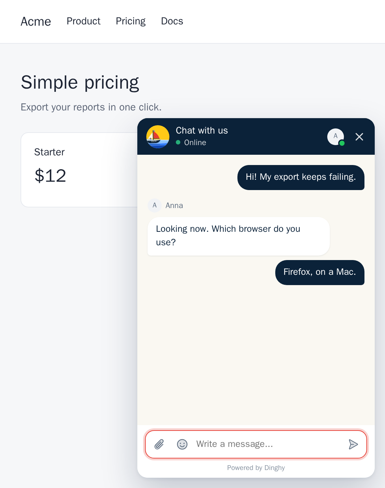

# Add the chat to your website



## Add the tag

The installer prints your tag. You can also copy it from **Install by hand** in **Settings > Install** in the operator app. It looks like this:

```html
<script src="https://chat.example.com/widget/loader.js" data-key="wk_your_public_key" async></script>
```

Put it before the closing `</body>` tag, on every page that should have the chat.

Then add your website under **Allowed sites** in **Settings > Install**, with one origin on each line. An origin has the scheme and the host and no path, such as `https://www.example.com`. The chat does not work on a site that is not on this list. This includes `www` and the bare domain, which are two different origins.

The tag is safe to publish. The key in it only names your workspace. The tag loads a small script of under 4 KB, and the full chat loads only when a visitor opens it, comes back to a chat, or has an [outbound message](outbound-messages.md) waiting.

Put the chat on your own site, not on a page served from the same address as Dinghy. The chat does not work there, because a browser does not send an origin for a request to its own address.

## Change how it looks

The easiest way needs no code: **Settings > Appearance** in the operator app sets the colors, the side, the theme, the chat button, the corners, the boat, the words and when to ask for an email. The [operator guide](operator-guide.md#change-the-widget) explains it. Pages of your site that open after a save show the change within 5 minutes, and a page already open keeps the look it loaded with. The chat always shows a "Live chat by Dinghy" link to dinghy.chat under the message box.

You can also set the look in the tag. These attributes win over the saved settings, and `Dinghy.configure()` wins too:

| Attribute | Value | Effect |
|---|---|---|
| `data-primary` | A full hex color, such as `#112233` | The color of the header, the visitor's messages and the boat's hull |
| `data-accent` | A full hex color | The color of the buttons and the boat's sail |
| `data-mascot` | `false` or `true` | Hides or shows the boat in the open chat. Each state still shows its text |
| `data-launcher` | `bubble`, `label`, `square`, `boat` or `hidden` | The chat button. `label` shows the chat's title beside the icon, and `hidden` lets you open the chat from your own button |
| `data-position` | `left` or `right` | The corner for the button and the chat |
| `data-offset-x` | Pixels, such as `24` | The distance from the side of the window. The default is `16` |
| `data-offset-y` | Pixels, such as `80` | The distance from the bottom of the window. The default is `16` |
| `data-locale` | `en`, `fr` or `es`, or a tag such as `fr-CA` | The language of the widget's own words, over the **Language** setting |

A color in any other form, such as `red` or `#123`, is ignored. So is an offset that is not a whole number of 0 or more.

So the order is: the tag's attributes and `Dinghy.configure()`, then the saved settings, then Dinghy's defaults. The loader asks your Dinghy server for the saved settings and draws the chat button once they arrive, so the button never changes shape. If your server cannot answer, the button draws from the tag and the defaults. If the workspace's widget is off, such as for a suspended workspace, nothing shows.

To match your fonts and corners, set these CSS variables on the `dinghy-chat` element. They win over the corners in the saved settings, and each one falls back to them:

```css
dinghy-chat {
  --dinghy-font: "Inter", system-ui, sans-serif; /* the chat's text */
  --dinghy-radius: 12px; /* the chat panel's corners, 16px by default */
  --dinghy-launcher-radius: 12px; /* the square and boat buttons' corners, 16px by default. The bubble is round */
}
```

## Control it from your page

The tag adds a `Dinghy` object to the page:

| Call | What it does |
|---|---|
| `Dinghy.open()` | Opens the chat |
| `Dinghy.open({ message })` | Opens the chat with `message` in the message box, unless the visitor already typed something there. The visitor still sends it |
| `Dinghy.close()`, `Dinghy.toggle()` | Closes the chat, or opens it if it is closed |
| `Dinghy.show()`, `Dinghy.hide()` | Shows or hides the chat button. `data-launcher="hidden"` only sets how it starts |
| `Dinghy.identify(token)`, `Dinghy.reset()` | Signs a user in and out. See [Show who is chatting](#show-who-is-chatting) |
| `Dinghy.setContext(data)` | Tells operators about the page, such as a plan or a cart. See below |
| `Dinghy.configure(options)` | Changes the colors, the side, the offsets and the z-index now |
| `Dinghy.nudge()`, `Dinghy.nudge(false)` | Pulses the chat button until the next open, or stops it. See [Outbound messages](#outbound-messages) |
| `Dinghy.nudge({ text, message })` | Pulses the chat button and shows `text` in a card above it. A click opens the chat with `message` in the message box. See [Offer help from your page](#offer-help-from-your-page) |
| `Dinghy.on(event, callback)` | Calls `callback` on each event, and returns a function that stops it |
| `Dinghy.state` | `{ ready, open, unread, conversation, visitorId, nudging }`, read only. `visitorId` is null before the visitor exists and after `reset()` or `identify()` until the chat knows the next visitor, and `nudging` says whether the chat button pulses |

### Use your own button

Hide the chat's button with `data-launcher="hidden"`, then open the chat from yours:

```html
<button onclick="Dinghy.open()">Chat with us</button>
```

To start the visitor's message for them, pass it. It waits in the message box, and nothing is sent until the visitor sends it. The visitor can change it first. If the box already holds words the visitor typed, they stay, and `message` is dropped. Dinghy stores the message nowhere, so a reload empties the box:

```html
<button onclick="Dinghy.open({ message: 'I have a question about my invoice' })">
  Ask about billing
</button>
```

This also works before the tag loads, from the queue in [Call it before it loads](#call-it-before-it-loads): `["open", { message: "..." }]`.

### Keep your page in step with the chat

The chat tells your page when it opens and when it closes, also when the visitor closes it from inside the chat. `Dinghy.state.open` says whether it is open now:

```js
Dinghy.on("open", () => helpButton.setAttribute("aria-expanded", "true"));
Dinghy.on("close", () => helpButton.setAttribute("aria-expanded", "false"));
```

You do not need to reopen the chat after a reload. If the visitor has a conversation, or your page called `identify()`, and the chat was open when the tab reloaded, it opens again by itself. A closed chat stays closed, and a new tab starts closed. The `open` event fires when it opens again.

### Show your button only during a conversation

`Dinghy.on("conversation")` tells your page whether the visitor has an open conversation. With `data-launcher="hidden"`, this shows the chat's button only while one is going, and your own Help menu opens the chat the rest of the time:

```js
Dinghy.on("conversation", (open) => (open ? Dinghy.show() : Dinghy.hide()));
```

It runs at once with `false`, then with `true` once the chat has asked Dinghy, on each page load and when the tab comes back. A signed-in user who chatted on another device sees the button too, because `identify()` loads their conversations. After `reset()`, it runs with `false`. A conversation an operator closes still counts until the next page load, or until the tab comes back.

### Listen to events

```js
// Show your own unread count. It runs at once with the current count, then on each change.
const stop = Dinghy.on("unread", (count) => {
  document.querySelector("#help-badge").textContent = count || "";
});
stop(); // Stops listening.

Dinghy.on("open", () => analytics.track("chat opened"));
Dinghy.on("message:sent", ({ body }) => analytics.track("chat message sent"));
```

| Event | When | Callback gets |
|---|---|---|
| `ready` | The full chat has loaded | Nothing |
| `open`, `close` | The chat opens or closes | Nothing |
| `unread` | The unread count changes, and once at once | The count |
| `conversation` | The visitor starts or ends having an open conversation, and once at once | `true` or `false` |
| `message:sent` | The visitor's message reached Dinghy | `{ body }`, with `body` null for an image or a file |
| `message:received` | A message from the team arrives while the page is open, also an [outbound message](#outbound-messages) that waits when the page loads | `{ id, body, sender, outbound }`. See below |
| `conversation:started` | The visitor's message started a new conversation. A message after a close reopens the conversation instead, and does not send this | Nothing |
| `visitor` | The visitor now exists, such as after their first message or a sign-in. `ready` keeps its meaning: the full chat has loaded. After `reset()` or `identify()` it fires with null, until the chat knows the next visitor | The visitor's ID, or null |
| `nudge` | The chat button starts or stops pulsing | `true` or `false` |
| `outbound:read` | The visitor read an outbound message | `{ id, button }` |
| `outbound:dismissed` | The visitor chose an outbound message's dismiss button | `{ id, button }` |

`message:received` gets `{ id, body, sender, outbound }`. `id` is the message's ID, and null for an outbound message that is in no conversation yet. `body` is null for an image or a file. `sender` is `{ name, pictureUrl }`, the person or the workspace the visitor sees, either of them possibly null. `outbound` is `{ id, campaignId, show, buttons }` for an outbound message that waits, and null for a reply. `campaignId` is the [campaign](campaigns.md) it came from, or null. `outbound.id` is null for a [page campaign](#page-campaigns)'s message until the visitor answers it. `outbound:read` and `outbound:dismissed` get the outbound message's `id` and `campaignId`, and `button`, the `{ value, label }` the visitor chose, or null.

A callback that throws does not stop the chat or the other callbacks. The browser reports its error.

### Outbound messages

Your server can send a visitor an [outbound message](outbound-messages.md), before they ever chat. The widget fetches the visitor's waiting messages when the page loads, when `identify()` sets a new user, on its beat each minute, and over its stream while the chat is open. A page with nothing waiting loads nothing more. Each message shows as its `show` says:

- `badge`: the chat button pulses and the unread count goes up. The message is in the chat when the visitor opens it.
- `preview`: a card above the chat button, with the sender's face, the first lines and the message's buttons. A click opens the chat. Its close button only hides the card, and the message stays in the chat. The widget shows one card at a time, the newest, and counts the others in the badge. Screen readers hear the card, as it is `aria-live="polite"`.
- `chat`: the chat opens. It shows as `preview` instead on a phone, after the visitor closed the chat on this page, and while an input of your page has focus.

With `prefers-reduced-motion`, the badge stays still and the card does not slide. A message that arrives while the visitor types never moves the message box or takes the focus.

`Dinghy.nudge()` pulses the chat button until the visitor next opens the chat, and `Dinghy.nudge(false)` stops it. It stays in the page and tells the server nothing. A `badge` message starts it too. `Dinghy.state.nudging` and the `nudge` event follow it.

### Offer help from your page

When your page sees the visitor struggle, such as a failed save, it can offer help without opening the chat:

```js
// page
Dinghy.nudge({
  text: "We saw an error while you saved. Can we help?",
  message: `I got an error while saving (error ID ${errorId}).`,
});
```

Your card shows `text` above the chat button, as plain text, and the button pulses. A click on the card or the button opens the chat with `message` in the message box, as `Dinghy.open({ message })` does, so the visitor sends the error ID with their question. `message` is optional. Your card and `message` stay in the page. Once the visitor changes the message, it is their draft, and operators see it as they type when typing previews are on. The card and the message box can be reached from the keyboard.

The card's close button, `Dinghy.nudge(false)`, the next open and `Dinghy.reset()` remove your card. Another `nudge({ text })` replaces it, and a plain `nudge()` keeps it. While the chat is open, your card waits until the visitor closes it.

Your card shows in place of a waiting outbound message's card, which comes back once yours is gone. Closing yours keeps the pulse of an outbound message that waits.

With `data-launcher="hidden"` and your own button, `badge` raises the unread count as a reply does, and `preview` shows its card in the configured corner, with the same offsets. To pulse your own button:

```js
// page
Dinghy.on("nudge", (on) => helpButton.classList.toggle("pulse", on));
```

`message:received` carries what you need to draw your own card: the text, the sender's name and picture, and the buttons:

```js
// page
Dinghy.on("message:received", ({ body, sender, outbound }) => {
  if (outbound !== null) showHelpCard({ name: sender.name, picture: sender.pictureUrl, body });
});
```

A message for a signed-in user reaches them once your page calls `identify()`. A visitor who is not signed in has an ID once they exist, in `Dinghy.state.visitorId` and the `visitor` event. Your page can pass it to your server, which can then send to `{ "id": visitorId }`.

### Page campaigns

A [campaign](campaigns.md) with a `page` trigger runs in the visitor's browser, with no code on your page. The loader's beat answers the live page campaigns for this visitor, each with a URL pattern and a number of seconds. When the page's address matches, such as `/pricing*`, and the visitor stays that many seconds, the widget shows the campaign's message as a badge or a card, as an outbound message shows. It shows each page campaign at most once per page load, and once per tab in a single-page app.

Until the visitor answers, Dinghy stores nothing about them for it. The widget tells the server that the message showed, was read or had a button pressed, and the server only counts these in the campaign's results. When the visitor answers, the campaign's message goes in the conversation first, then their answer, as for any outbound message.

The loader checks the address when the page loads and on its beat, once a minute, so in a single-page app a new address counts within a minute. It remembers the page campaigns it showed in the page's own memory and stores nothing in the browser, so a reload shows them again.

### Tell operators about the page

`setContext` sends facts from your page that help operators answer, such as the visitor's plan or what is in their cart:

```js
Dinghy.setContext({ plan: "pro", cartTotal: 129.5, trial: false });
```

It takes up to 20 keys of up to 40 characters. Each value is a string of up to 200 characters, a number, `true`, `false` or `null`. The widget drops anything else, and cuts a longer string. Each call replaces the last one.

The widget sends it only for a visitor who has chatted: after their first message, and again on each later call. Operators see it next to the conversation, marked as sent by the page and not checked. Anyone can change what their own browser sends, so do not trust it for anything that matters. For facts you can vouch for, sign them in the `attributes` of [the identity token](#show-who-is-chatting).

### Change the look while the page runs

```js
Dinghy.configure({ accent: "#e5352b", position: "left", offsetX: 24, offsetY: 80, zIndex: 1000 });
```

It takes the same values as the tag's attributes, and ignores one that is not valid. `zIndex` is a whole number of 0 or more, and it is `2147483000` by default. `locale` picks the chat's language, as `data-locale` does: call `Dinghy.configure({ locale: "fr" })` before the chat opens, such as from your own language switch, and the next page load picks up a later change.

### Call it before it loads

The script loads with `async`, so `Dinghy` may not exist yet when your own script runs. To call it early, queue the calls before the tag. Every call works this way, `on` too:

```html
<script>
  window.Dinghy = {
    q: [
      ["on", "unread", (count) => console.log("unread", count)],
      ["open", { message: "Hello" }],
    ],
  };
</script>
<script src="https://chat.example.com/widget/loader.js" data-key="wk_your_public_key" async></script>
```

### Install it from npm

In an app with a bundler, the `@dinghy-chat/widget` package adds the tag for you and gives typed calls:

```sh
npm install @dinghy-chat/widget
```

```ts
import { init } from "@dinghy-chat/widget";

const dinghy = init({
  url: "https://chat.example.com",
  key: "wk_your_public_key",
  accent: "#e5352b",
  position: "left",
  launcher: false, // the same as data-launcher="hidden"
});

dinghy.on("unread", (count) => setBadge(count));
dinghy.open({ message: "I need help with my order" });
```

`init` adds the tag once, however often it runs, and returns the same `Dinghy` object. Calls made before the script loads wait for it. It takes `url`, `key` and the options of the tag: `primary`, `accent`, `mascot`, `launcher`, `position`, `offsetX`, `offsetY`, `zIndex` and `locale`. The package also exports the types, such as `DinghyApi` and `DinghyEvents`.

### Ask a coding agent to install it

Paste this prompt into your coding agent, such as Claude Code, with your own address and key:

```text
Add the Dinghy live chat to this app. My Dinghy server is https://chat.example.com and my
public key is wk_your_public_key.

1. Load the widget on every page where visitors may need help. In a plain site, add
   <script src="https://chat.example.com/widget/loader.js" data-key="wk_your_public_key" async></script>
   before </body>. In an app with a bundler, install @dinghy-chat/widget and call
   init({ url, key }) once at startup, in the browser only.
2. If the app has a Content Security Policy, allow https://chat.example.com in script-src,
   connect-src and img-src.
3. If users sign in, add a server route that signs an HS256 JWT with the workspace's signing
   secret from an environment variable (never in client code), with sub = the user's ID,
   aud = the public key, iat, exp at most 24 hours later, and the optional name, email and
   attributes. Call Dinghy.identify(async () => fetch that route's token) after sign-in, and
   Dinghy.reset() at sign-out.
4. Where it helps support, call Dinghy.setContext({ ... }) with a few facts such as the plan.
5. Read https://dinghy.chat/docs/add-to-your-site and https://dinghy.chat/llms.txt for the
   full API, and do not add anything else.
```

## Show who is chatting

With no more work, a visitor is anonymous. Their chat stays in that browser, and they can leave an email in the chat so you can reply if they leave. A browser that does not come back for a year starts a new chat.

If your site has logins, you can tell Dinghy who the user is. Their chat then follows them to every device, and operators see their name, email, your user ID and any custom attributes you send. An anonymous chat from before the sign-in does not merge into it, and the widget shows the user's own chat.

Your server signs a short token with the workspace's signing secret, and your page passes it to the widget.

**1. On your server,** sign the token. Copy the secret from **Identify signed-in users (optional)** in **Settings > Install**, and keep it on your server only. This example uses the `jose` package for Node:

```js
import { SignJWT } from "jose";

const secret = new TextEncoder().encode(process.env.DINGHY_SIGNING_SECRET);

export function dinghyToken(user) {
  return new SignJWT({
    name: user.name,
    email: user.email,
    attributes: { plan: user.plan, account: `https://admin.example.com/users/${user.id}` },
  })
    .setProtectedHeader({ alg: "HS256" })
    .setAudience("wk_your_public_key")
    .setSubject(String(user.id))
    .setIssuedAt()
    .setExpirationTime("1h")
    .sign(secret);
}
```

Any JWT library works, in any language. The token must have these fields:

| Field | Value |
|---|---|
| Algorithm | `HS256` |
| `aud` | Your public key from the tag |
| `sub` | Your user's ID, up to 255 characters |
| `iat` and `exp` | The issue time and the expiry, at most 24 hours apart |
| `name` | Optional. The name operators see, on one line, up to 100 characters. Anything else is dropped |
| `email` | Optional. One address, which operators see. Anything else, such as a list, is dropped |
| `attributes` | Optional. Custom attributes that operators see, such as a plan, up to 2 KB of JSON. They merge key by key into the contact's attributes, and a `null` value removes a key. A value that starts with `https://` or `http://` shows as a link |

**2. On your page,** pass a function that asks your server for a token. The widget calls it again when a token expires, so a tab that stays open keeps working:

```js
Dinghy.identify(async () => {
  const response = await fetch("/api/dinghy-token", { method: "POST" });
  return response.text();
});
```

You can also pass the token as a string, but a string cannot renew itself. Call `identify` on each page load, because the widget does not store this token.

A person who chatted before signing in, in the same browser, keeps that chat: the first time the signed-in widget loads, the conversations of the signed-out visitor move to the signed-in contact, and the signed-out visitor is gone. The contact keeps the name, email and attributes your token signs.

**3. When the user signs out,** call this. It ends the chat in this browser, so that the next person on a shared computer cannot read it:

```js
Dinghy.reset();
```

Your server can also set the name, email and attributes with no page at all, through the [contact upsert](outbound-messages.md#contacts), `PUT /v1/operator/workspaces/{workspaceId}/contacts/by-user/{userId}` with an API key. It creates the contact when it does not exist, so an [outbound message](outbound-messages.md) can reach a user before their first visit. Both write the same contact. Attributes merge key by key, and an attribute your token leaves out stays. Each write carries its time, a token's being its `iat`, and the later write wins for each field and each attribute, so a token signed before an upsert does not undo it.

If you replace the signing secret in **Settings > Install**, tokens signed with the old one stop working at once. Update your server at the same moment.

## If your site has a Content Security Policy

Allow your Dinghy address in these directives. Dinghy needs no `unsafe-inline`:

```text
script-src https://chat.example.com;
connect-src https://chat.example.com;
img-src https://chat.example.com;
```

If your Dinghy serves images and files from a separate origin (`UPLOADS_ORIGIN`), allow that origin in `img-src` and `connect-src` too, as the chat fetches a file to save it.

## What visitors can do

- Send text and images. They can paste, drag or pick an image. An image must be PNG, JPEG or WebP, under 5 MB and under 16 megapixels.
- Send files, while **Visitors can send files** is on in **Settings > Appearance**. It is on for a new workspace, and off for one from before the release that added files. A file can be a PDF, TXT, CSV, LOG, JSON, ZIP, DOC, DOCX, XLS, XLSX, PPT, PPTX, ODT, ODS, MP4 or MOV, up to 10 MB. The chat shows its name and size, and it only downloads, never opens in the page. Dinghy does not scan files for viruses.
- Read the chat again after a refresh.
- See an unread count on the button.
- Leave an email, if they are not signed in and your Dinghy install has a mail server. They then get your reply by email if they left the page. With no mail server, the widget does not ask.
- Write outside your [business hours](operator-guide.md#business-hours). The chat then says when your team is back, on the visitor's own clock, and asks for their email before the first message.
- Continue from the reply email. Its link opens the conversation on a page of your Dinghy server, at `https://chat.example.com/chat/...`, where they can read and reply. The link works for 30 days, and each email has a new one. The email still has the link that stops these emails.
- Answer the reply email from their mail app, if your server has [replies by email](self-hosting.md#replies-by-email) on. The answer goes into the same conversation and reopens it if it was closed.

## What operators see about a visitor

Once a visitor has chatted, the widget tells your Dinghy server the page they are on: when it loads, and when the address changes, also in a single-page app. It sends the page's address without its query string or `#` part, so a token or a search in the address never reaches Dinghy, and the page's title. The server also keeps a short line about the browser, such as "Chrome on macOS", and not the browser's full description. Operators see whether the visitor has the chat open now, or when they were last seen, and the pages the visitor went through. Dinghy keeps a visitor's newest 100 pages, for 90 days at most, and deletes them with the visitor's last conversation. While a visitor with an open conversation types, the widget sends the words in the message box at most twice a second, and empty words when the box empties, so operators see them before they are sent. The server passes them to the open operator apps and stores nothing. An owner or admin turns this off in **Settings > Workspace**, and then the widget stops sending unsent text.

The widget stores nothing in the browser of a visitor who never used the chat: no cookie, nothing in `localStorage` and nothing in `sessionStorage`. [Page campaigns](#page-campaigns) it showed live only in the page's memory. On a page load it asks for the chat's saved look, with no token and no cookie, and the browser keeps the answer for 5 minutes.

For the live view in **Visitors**, each tab also sends a small beat when the page loads and once a minute while the tab is visible, and a last one when the page closes. A beat holds a random ID for the tab, which lives only in the page's memory and is gone on the next page, the page's address without its query string or `#` part, its title, the site the visitor came from as an origin such as `https://news.example.org` on the first beat only, and the browser's time zone, such as `Europe/Paris`. Your Dinghy server looks up the country of the request's address in a database inside the server, and then drops the address: it is never stored. The tab stays in the live view, in Valkey only, until 90 seconds after its last beat. A beat never creates a visitor. Dinghy stores a visitor who never chatted only when your server creates them or sends them a message. A signed-in user counts as created by your server, since your server signs their token: the first request with it stores them. For a visitor Dinghy has stored, the beat carries their token, and the server saves their country and time zone with them, which operators see in the conversation and in **Contacts**. The beat also answers how many outbound messages wait for them, so the chat loads only when one does, and the live page campaigns for the visitor. Countries come from DB-IP's free IP to Country Lite database, under CC BY 4.0, which the Docker image downloads when it is built. A server without the file shows no countries, and everything else works.

The server also saves hourly site totals for visits, page views, peak traffic, top pages and referring sites. These totals have no stored visitor IDs and expire after 182 days. **Analytics > Your site** combines them with counts from conversations that visitors started.

The widget stores its own token in `localStorage` only once the visitor sends a message, and a signed-in user's token is never stored. For a visitor who has a token or is signed in, it also notes in `sessionStorage` that the chat is open, so the chat opens again after a reload in the same tab. That note goes when the chat closes or the tab closes.

## Change the chat's words

An owner or admin can change the chat's title, its greeting in an empty chat, and the line it shows when nobody is online, in **Settings > Appearance**. An empty field keeps Dinghy's own text.

The widget's own words, such as its buttons, come in English, French and Spanish. **Language** in **Settings > Appearance** picks one, or **Visitor's language**, which takes the first of the browser's languages that the widget speaks, and English when it speaks none of them. A new workspace starts with **Visitor's language**, and a workspace made before the setting keeps English. The tag's `data-locale` and `Dinghy.configure({ locale })` win over the setting, for a site that has its own language switch. The texts your team writes stay as written, in one language. English is in the chat's script, and the chat loads another language's words from your Dinghy server with the saved look, as a small file the browser keeps for 5 minutes.

The widget tells your Dinghy server its language once the visitor has chatted, so the reply emails, the transcript and the page that continues the chat use it too, with dates in that language. Operators see it in the visitor panel.

The widget lives in its own Shadow DOM, so your site's styles do not change it, and its styles do not change your site.
