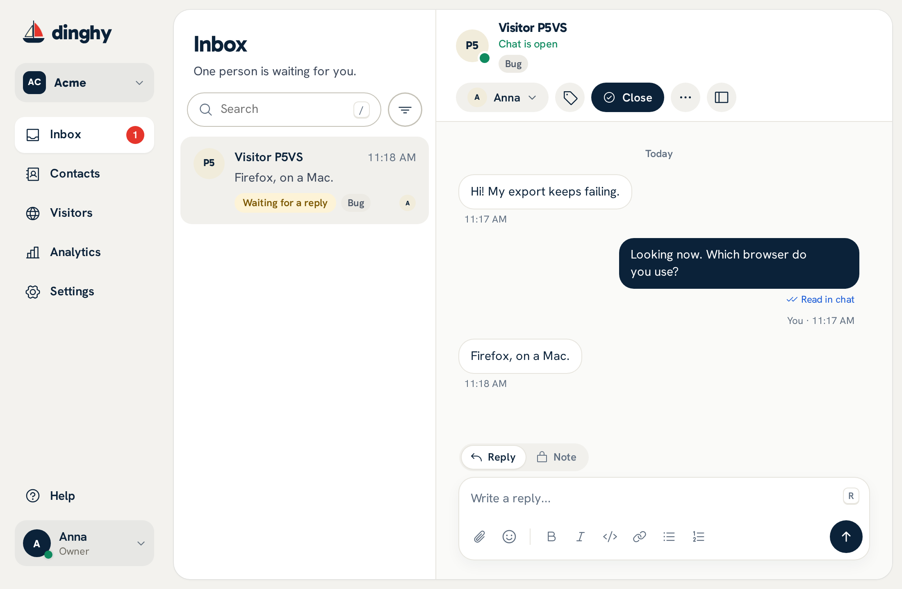
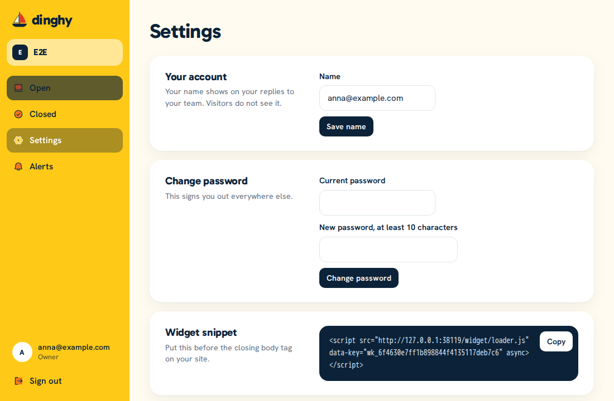

# Use the operator app

The operator app is where your team reads and answers chats. Open your Dinghy address in a browser, enter your email, and select **Email me a sign-in link**. Open the link in the email, and select **Sign in**. The link works once, for 15 minutes, and only the button uses it, so a mail scanner that opens it first does no harm. Dinghy has no passwords.



## Answer a chat

The sidebar has **Inbox**, **Contacts**, **Visitors**, **Analytics** and **Settings**. Until the first steps are done, owners and admins also see **Get started** above their name, with a ring and a count such as 2/6. It lists six steps, each of which opens its page: install the widget (done once a page of an allowed site loads it), add a logo, customize the widget, invite a teammate, turn on notifications for yourself, and send a test chat. Dinghy checks each one itself. **Hide for good** hides the steps for you on every device. New conversations appear in the **Inbox** with no reload. The red number counts the people who wait for a reply from you: conversations assigned to you or to nobody, not a teammate's, and not snoozed ones. The tab's title shows the same number, the tab's icon gets a red dot, and an installed app shows the number on its icon. The filter button beside the search opens **Open** and **Closed**, which pick the conversations the list shows, and in a team of more than one **All**, **Mine** and **Unassigned**, which pick whose, and once your team has labels, **Label**, which lists only the conversations with one label. A dot on the button says a filter is on. The app remembers them in the address, so a reload or a shared link keeps them. Select one to read it, write in the reply box, and press Enter or the send button. If your site sends details with `setContext()`, they show in italics under **Details**. Visitors can change these details in their browser, so do not use them to verify identity or account access.

Messages can carry a little formatting, written as Markdown: `**bold**`, `*italic*`, `` `code` ``, a block between two lines of three backticks, `[words](https://example.com)` for a link, and lines that start with `-` or `1.` for a list. A web address becomes a link by itself. The buttons under the reply box, and Cmd or Ctrl with B, I, E and K, add the marks around the selected words. Visitors see the formatting in the widget and in reply emails, and can type it too. Links open in a new tab, and only `http`, `https` and `mailto` links work. HTML, images and headings stay plain text.

To send an image or a file, paste it, drag it onto the chat, or select the attach button. An image must be PNG, JPEG or WebP, under 5 MB and under 16 megapixels. A file can be a PDF, TXT, CSV, LOG, JSON, ZIP, DOC, DOCX, XLS, XLSX, PPT, PPTX, ODT, ODS, MP4 or MOV, up to 10 MB. A file shows as its name and size, and selecting it downloads it: Dinghy never opens a file in the page. Dinghy does not scan files for viruses, so open a visitor's file with the care you give an email attachment. A CSV can hold spreadsheet formulas that run when a spreadsheet app opens it, so open a visitor's CSV with the same care, or import it as plain text.

Visitors can send the same files, unless an owner or admin turns off **Visitors can send files** in **Settings > Appearance**. Your team can always send files.

If a message shows "Not sent", select it to try again. A retry cannot create a second copy.

To write something only your team sees, choose **Note** above the reply box, write it and select **Add note**. The box turns yellow, and the note shows in a yellow bubble labeled **Internal note** with its author. The visitor never sees a note, in the chat or in an email, and a note does not assign the conversation. You can edit your own notes at any time and delete them as replies. A note can quote any message, but a reply cannot quote a note. Notes take text only, and the box goes back to **Reply** when you open another conversation.

To ask a teammate about a chat, type **@** in a note and pick them from the list, or type `@` and their name as it shows in **Team**. The note keeps `@Name` in its text. Each teammate it mentions, up to 10, gets an alert with the note's text, by push and by email as their [alert settings](#get-alerts) say, even when the chat is not theirs, and the conversation shows as unread for them. A note with no mention alerts nobody. When you edit a note, only the teammates it did not mention before get an alert, and the conversation stays as they last read it.

To answer a common question in your team's words, type **/** at the start of a word in the reply box or the note box. A list shows the [saved replies](#saved-replies) whose shortcut holds what you type after it. Use the arrow keys to choose one, and press Enter or Tab to put its text in the box, where you can change it before you send. Esc closes the list.

To sort conversations, such as billing questions or bug reports, give them labels. Press **L** in a conversation, or select the tag button beside **Who answers** or in the panel on the right. Type to find a label, and check or uncheck it. To make a new one, type its name and press Enter, or select **Add "name"**. Anyone on the team can do this, and a workspace keeps up to 100 labels. Labels show as small colored pills under the visitor's name in the conversation, and on its row in the Inbox. Owners and admins rename, recolor and delete them in [Settings > Labels](#labels).

To act on several conversations at once, choose them in the list. Point at a row and check the box over its picture, press **X** on the open conversation, or hold Shift and check a box to choose every row between it and the last one you chose. On a phone, press and hold a row, then tap the others. While rows are chosen, a bar takes the search's place and shows how many are chosen. The box beside the count chooses every row the list shows. The bar's buttons **Close** them, **Assign** them and **Label** them, and the **More actions** menu has **Mark read** and, for owners and admins, **Delete**, which asks first with the count, such as "Delete 12 conversations?". In a read-only or suspended workspace, the bar has **Mark read** alone. Each conversation changes as it would alone, so webhooks and alerts behave the same. A message then says how many changed, how many needed no change, such as a conversation that was closed already, and how many were skipped. If the connection fails partway, it says what was done before it. The cross or Esc clears the choice. There is no reply to many at once.

When you close a conversation, a visitor who gave an email gets the whole conversation by email 5 minutes later, if someone on the team replied, with a link to continue the chat. Reopening it within the 5 minutes cancels it. **Email transcript** in the conversation's **…** menu sends it now. **Settings > Appearance** turns the email at close off.

Under your team's last reply, a small line says how far it got: **Sent** when Dinghy stored it, **Sent by email** when a reply email carried it to the visitor, **Email failed** when that email could not go, and **Read in chat** once the visitor has seen it in the widget. Point at an earlier reply to see its line. The line changes by itself when the visitor reads.

When your server has [replies by email](self-hosting.md#replies-by-email) on, a visitor can answer a reply email or a transcript. Their answer goes into the conversation that email was about, reopens it if it was closed, and alerts you like any message. A small line under it says **Replied by email**. Dinghy keeps what they wrote above the quote of your email, and up to 5 attachments with the chat's limits. When an attachment could not go in, the message says so. If the answer came from an address other than the visitor's email, such as an address it was forwarded from, the line says **Replied by email from another address**. The reply address proves which conversation the answer belongs to, not who wrote it, so check before you share account details.

If two of you open the same conversation, each sees "… has this conversation open", so you do not answer twice. It means only that the conversation is open on their screen.

While a visitor with an open conversation types in the widget, the thread shows their words in a faded bubble with moving dots, and the Inbox shows **typing…** in place of the last message. It goes when they send, empty the box, or stop for 6 seconds. Dinghy does not store these words. An owner or admin turns this off with **Show what visitors type before they send** in **Settings > Workspace**, and then the widget sends nothing until the visitor sends.

**Visitors** shows who is on your site now: a world map with a yellow dot for each country, larger with more people, and below it each open page with its country, the visitor's local time, the page, how long they have been on the site, their device and where they came from. A visitor who has chatted shows their name and **Chatting**, which opens their conversation. The number next to **Visitors** in the sidebar counts them. A tab leaves the list a minute and a half after it closes or goes to the background. [What the widget sends](add-to-your-site.md#what-operators-see-about-a-visitor) explains what this collects.

To find a conversation, type at least three characters in the search box above the list. It searches open and closed conversations by the visitor's name, email or user ID, and by what anyone wrote, and shows the matching message under each one. Press Escape or empty the box to go back to the list.

Under the visitor's name, the header shows their email and user ID, when the name does not already show them, and the page where they started. The next line shows **Chat is open** while the visitor has the chat open, or when they were last seen, then their browser and system, such as "Chrome on macOS". Below that is the last page they were on, which opens in a new tab; when it is the page where they started, the header names it only once. If Dinghy cannot tell whether they are online, it says nothing about it. On the right are the controls:

| Control | What it does |
|---|---|
| Who answers | A list that gives the conversation to one person on your team or to the whole team, which takes it from a bot, or back to the bot that took part last |
| **Close** | Moves it under **Closed** in the Inbox. **Reopen** brings it back. If the visitor writes after a close, their message reopens it, with its assignee |
| **…** then **Snooze** | Keeps it open, but out of the people waiting for you: **until they reply**, **until tomorrow** (9:00 your time) or **until next week** (Monday 9:00). The list shows **Snoozed** in place of **Waiting for a reply**. A message from the visitor ends it, and your own replies do not. **Unsnooze** in the same place ends it now, and so does a close |
| **…** then **Block** | Stops this visitor from sending messages. **Unblock** in the same place undoes it, and so does **Blocked visitors** in **Settings > Workspace** |
| **…** then **Delete** | Deletes the conversation and its images and files for good, after you confirm. Owners and admins only |

For a signed-in user, the conversation shows the name, email, user ID and custom attributes that [your site sent](add-to-your-site.md#show-who-is-chatting). An attribute that is a web address is a link.

On the right of a conversation, a panel shows who the visitor is: their name, email and whether the chat is open, who answers and the status, their country with its flag, local time, device, the language of their chat and current page, then folds for **Details** (the user ID, the signed attributes, and what the page sent in italics), **Pages visited**, **Other conversations** of the same person, and a **Note** that only your team sees, saved when you click away. Each fold opens or closes, and the browser remembers it. The button at the right of the header shows or hides the panel. On a screen under 1200 pixels wide, it opens over the conversation instead.

**View contact** opens the person's page under **Contacts** in the sidebar. **Contacts** lists everyone who has started a conversation, with their company (a signed `company` attribute), country, when they were last seen and first seen, and how many conversations they had. Search by name, email or user ID, sort by last or first seen, and **Export CSV** downloads them all. A contact's page shows the person on a blue band: their name, **Signed in** when your site signs them in, their company, email with a copy button, and whether they are on your site now with the page they are on, or when they were last seen. **Open conversation** opens their newest open conversation, or their newest one when none is open. Tiles show their local time, location, device, when they were first seen and how many conversations they had. Under them, **Conversations** lists each conversation with its status, last message, message count, assignee or who closed it, and how long the first reply took, and **Pages visited** shows the pages as a timeline, with a pause of over 30 minutes starting an earlier visit and the current page marked **Here now**. Beside them are the **Note** and **Details from your site**. The **…** menu has **Edit name and email** for a visitor your site did not sign in, **Block** or **Unblock**, and for owners and admins **Delete contact**, which deletes the person with all their conversations, messages and images.

**Pages visited** lists the pages the visitor went through after they first chatted, newest first, with how long ago. Each one shows the page's title, or its address when it has none, and opens in a new tab. It shows 5, and **Show all** shows up to 20. The list reads the pages again every 30 seconds. Dinghy keeps a visitor's newest 100 pages for 90 days, and deleting the visitor's last conversation deletes them.

## Keyboard shortcuts

Press **?** anywhere in the app, or open **Help** at the bottom of the sidebar, for the list of keys. **Help** also links to these docs. The app shows a key where it applies too: next to a sidebar item when you point at it, in the empty search and reply boxes, and in a button's tooltip.

| Key | What it does |
|---|---|
| **?** | Shows every shortcut |
| **/** | Puts the cursor in the search box |
| **G** then **I**, **C**, **V**, **A** or **S** | Opens Inbox, Contacts, Visitors, Analytics or Settings |
| **J** and **K** | Open the next or the previous conversation in the list |
| **X** | Chooses the open conversation for a [bulk action](#answer-a-chat), or takes it out |
| **R** and **N** | Put the cursor in the reply box, as a reply or as a note |
| **E** | Closes the conversation and opens the next one in the list. On a closed conversation, reopens it |
| **A** and **I** | Open **Who answers**, or assign the conversation to you |
| **L** | Opens the conversation's labels |
| **.** | Opens the **…** menu |
| **P** | Shows or hides the visitor's panel |
| **Esc** | Leaves the reply box, so the keys work again. On a small screen, it also goes back to the list |

The keys work only while you are not typing in a box. If you use speech input, or keys run by mistake, turn off **Single-key shortcuts** in the list of keys. This applies only to this browser.

## See how support is going

Select **Analytics** in the sidebar. Every member can see it. Pick the last 7, 30 or 90 days in the list at the top right. Days and hours are in your browser's time zone, which the line under the title names.

Every number is about the conversations that started in that period:

| Number | What it means |
|---|---|
| **Conversations started** | How many started |
| **First reply time (median)** | Half of the answered ones got their first reply within this time, counted from the conversation's start. Unanswered ones do not count |
| **First reply time for 90% of answered chats** | 9 in 10 of the answered ones got their first reply within this time. Unanswered ones do not count |
| **First reply within 5 minutes** | The share of all of them, answered or not, with a first reply within 5 minutes |
| **Started in this period and now closed** | How many of them are closed now |

Under a number, a change compares it with the period of the same length just before, so a week that ends now is compared with the 7 days before it.

A first reply can come from a person on your team or from software that uses an [API key](api.md#api-keys). Both count. On Dinghy Cloud, the welcome chat counts nowhere.

Below are the conversations per day, **Who sent the first reply**, by person or API key, the busiest hours, as a grid of weekdays by hours where a darker square means more conversations started then, and **Conversations by label**, which counts the period's conversations by each label they have now. Hold the pointer over a bar or a square to see its number. With no conversation in the period, the page says so.

## Get alerts

Open **Settings > Notifications**. These settings affect only you, and each one has its own scope.

- **Browser notifications** sends a push notification when a visitor writes, and when a teammate mentions you in a note. It is set per browser, and covers every workspace you are in. Turn it on in each browser you use. Select **Turn on**, then **Send a test** to see if it works. A private window usually cannot turn this on.
- **Email me about new messages** is set per workspace, so turn it on in each workspace where you want emails. It needs a mail server on your Dinghy install. A burst of messages in one conversation sends one email. A note that mentions you sends its own email each time.
- **Play a sound for new messages** is set per browser. It plays a short chime when a visitor writes in a conversation you don't have open, or while the app's window is in the background. It is on unless you turn it off. The browser plays it only after your first click or key press in the app. A tab you are not on holds no live connection, so it stays silent: turn on notifications for that.

On an iPhone, a web app can show notifications only from the Home Screen:

1. Open your Dinghy address in Safari.
2. Select Share, then **Add to Home Screen**.
3. Open Dinghy from the Home Screen, and turn on notifications there.

On Android and on a computer, you can install the app from the browser's menu, but it is not necessary.

A phone can delay or drop a notification, so do not rely on one for urgent work.

## Your profile

Select your name at the bottom of the sidebar, then **Profile**. This opens **Settings > Profile**, where you change the name your teammates see. Visitors see only your first name, next to your replies. **Sign out** is in the same menu.

The same menu sets you **Available** or **Away**, and a dot on your picture shows which: green or gray. It holds in every workspace until you change it. The chat on your site says the team is online while one member is available with the app open, even in a background tab. While you are away, it does not count you, and it says so at its next check, within 30 seconds. Your team still sees which conversation you have open.

**Picture** in **Profile** sets your picture from a PNG, JPEG or WebP of up to 2 MB. Dinghy cuts it to a square. Visitors see it next to your replies and at the top of the chat, and your team sees it in place of your initials in the inbox, a conversation and **Team**. It is the same in every workspace.

**Theme** picks light, dark or **Use device setting** for the operator app. It applies only to this browser.

### Two-step sign-in

After the email link, two-step sign-in asks for a 6-digit code from an authenticator app, such as 1Password, Google Authenticator or Authy. Someone who can read your email still cannot sign in. API keys and connected apps do not use it: they are workspace keys, not sign-ins.

To turn it on, open **Profile**, select **Turn on** under **Two-step sign-in**, and scan the QR code with the app, or type the key under it. Enter the code the app shows, then select **Turn on**. Dinghy then shows 10 recovery codes, once. Copy or download them, and keep them somewhere other than your phone. Each one signs you in once in place of a code. Your other open sessions ask for a code at their next request.

Each new sign-in then opens **Enter your code** after the link. Nothing else in the app works until you enter a code from the app or a recovery code. A code works once. After 5 wrong codes in 15 minutes, Dinghy signs you out and refuses every code until 15 minutes after the first wrong one.

To turn it off, select **Turn off** and enter a code from the app or a recovery code. Sessions that never passed the check end.

**Settings > Team** shows who has it on.

If you lose your phone and your recovery codes, ask the person who runs your Dinghy server to run `chat two-factor-reset <email>`, as [Self-hosting](self-hosting.md#common-commands) shows. It turns two-step sign-in off and ends your sessions. On Dinghy Cloud, write to hello@dinghy.chat. Support resets it only with proof from outside your mailbox, such as the invoice number and the last four digits of the card, because anyone who reads your mailbox already has the first step.

### Delete your account

**Delete my account** is in **Profile** too, on the payment screen, on the screen that asks for an invite, and on the workspace setup once you have been in a workspace. It takes you out of every workspace, ends your sessions, and erases your name and email. The workspaces keep their conversations, and your old replies show as from "Former team member".

A workspace where you are the only owner does not stop the delete. If other people are in it, the admin who joined first becomes its owner, or, with no admin, the member who joined first. If nobody else is in it, it is deleted with your account, with all its conversations, and on Dinghy Cloud its subscription ends. The dialog lists what happens to each of these workspaces before you confirm.

A self-hosted server keeps its last workspace. If you are the only person in it, your account stays. To delete your workspaces one by one instead, use **Delete workspace** on each workspace's **Workspace** page.

With a mail server, Dinghy emails you a confirmation link. Open it within 15 minutes, then select **Delete my account**. Opening the link deletes nothing. Without a mail server, you type your email to confirm, and the account goes at once.

## Set up your team

Everyone can open **Settings**. A list on its left groups the pages:

| Group | Pages |
|---|---|
| **You** | **Profile**, **Notifications** |
| **Workspace** | **Workspace**, **Team**, **Saved replies**, **Labels** |
| **Chat widget** | **Appearance**, **Install** |
| **Developers** | **API & webhooks** |

Each page has its own address, such as `/settings/team?workspace=<id>`, so a reload, a bookmark or a shared link opens the same page of the same workspace. On a phone, the list is its own screen, and **Back** on a page returns to it. A member sees **Profile**, **Notifications**, **Team**, **Saved replies** and **Appearance**, and cannot change the team or the chat's look. Owners and admins see every page, **Labels** too.

To invite someone, open **Settings > Team**, select **Invite someone** at the top of the page, enter their email, pick a role, and select **Send invite**. Dinghy emails them a link to join. Without a mail server, select **Create invite link** instead, and send the link to that one person. Pending invites show in the team list with their email and the days they have left. Select the trash icon, then **Cancel invite**, to cancel one. To send an invite again, invite the same email again: the old link stops working. A link works once and lasts 7 days, and only that email can use it.

Someone new opens the link, enters a name and selects **Join**. That creates their account, joins the workspace and signs them in. Someone who already has an account with that email selects **Join**, and Dinghy emails them a link that joins the workspace and signs them in. Someone already signed in with that email selects **Join** at once. Without a mail server, nothing checks the email, so send the link only to the person it is for. Someone who already has an account there signs in first, then opens the invite.

| Role | Can do |
|---|---|
| **Member** | Answer, assign, close and block |
| **Admin** | The above, and delete conversations, change settings, and invite or remove members |
| **Owner** | The above, and invite admins, change roles, and download exports |

A workspace always keeps an owner. While you are the only one, your role stays **Owner** and you cannot leave: make someone else an owner first.

Someone in two workspaces switches between them with the workspace name at the top of the sidebar. On Dinghy Cloud, the same menu has **Create a workspace**.

## Change the widget

**Settings > Appearance** changes how the chat looks and behaves on your site, with no code. The preview beside the form shows each change before you save: the open chat, with the chat button under it, in light or dark colors. On a phone, the preview sits above the form, and **Hide the preview** folds it away.

- **Chat text**: the chat's title, its greeting before the first message and its message for when nobody is online. An empty field keeps Dinghy's own text. **Language** sets the widget's own words, such as its buttons, in English, French or Spanish, or **Visitor's language**, the first of the visitor's browser languages that the widget speaks, else English. Your title, greeting and away message stay as you wrote them. The preview shows the language this browser would get.
- **Colors and layout**: the main color and the accent color, the side of the page, the theme (light, dark, or **Use device setting**, which follows the visitor's device), the chat button (a bubble, a label with the chat's title, a square, a boat, or hidden so your own button opens the chat), the corner rounding, and whether the open chat shows the boat.
- **Header**: whose faces show beside the chat's title: **Online now** (the members online at the moment, or the members who replied last when nobody is), **Latest repliers**, **Members you choose** (in your order; a member who leaves the team is skipped), or **None**. Then how many, 1 to 5, and whether a green dot marks each member who is online. The **Status line** under the title says **Online** or your away message, or with **Usual reply time**, "Usually replies in 2 min" while someone is online, from the median first reply time over the last 30 days. Before the first reply, it says **Online**. The preview marks two members online, so you see the dots.
- **Email and branding**: when to ask visitors for their email, so you can reply after they leave: never, after their first message, or before it. Dinghy never asks a signed-in user, nor anyone when your server sends no email. A switch hides the "Powered by Dinghy" line under the chat.

**Save** sends the form. Pages of your site that open after the save show the change within 5 minutes, and a page already open keeps the look it loaded with. The browser asks before you leave the page with a change you did not save. The top of the chat shows the workspace's logo, which you change in **Settings > Workspace**. It also shows the faces that **Header** picks, by first name and picture. Attributes in your site's tag win over these settings: see [Add the chat to your website](add-to-your-site.md#change-how-it-looks).

### Business hours

**Settings > Business hours** says when your team answers. Owners and admins see it. Turn on **Use business hours**, pick the **Time zone**, which starts as your browser's, and give each day up to 3 ranges, such as 9:00 to 12:30 and 14:00 to 18:00. A day with no range is closed, and a range that ends at 00:00 runs until midnight.

Outside these hours, the chat's header shows your away message from **Settings > Appearance** and "We're back Monday at 9:00 AM", on the visitor's own clock, in place of **Online** or the usual reply time, even when a member is online. It asks for the visitor's email before the first message, or after it for a visitor who has chatted, whatever the email setting says, so your reply can reach them. Visitors can still write, and nothing is added to the conversation. Inside the hours, the header works as before. Pages of your site that open after a save follow the change within 5 minutes.

## The other settings

**Settings > Install** has four sections. Owners and admins see it.



- **Set up with an agent** has a prompt for Claude Code, Cursor or another coding agent, with **Copy prompt**. The agent installs the chat through [MCP](agents.md#set-up-the-chat-on-a-site) once you approve it in the browser.
- **Install by hand** has the tag for your site, with a **Copy** button.
- **Allowed sites** lists the sites that can load the chat, one per row. **Add a site** adds a row, and each row says if its address is not a site such as `https://example.com`.
- **Identify signed-in users (optional)** holds the identity signing secret, for [signed-in users](add-to-your-site.md#show-who-is-chatting). Ordinary chat does not need it. It stays hidden until you select the eye. **Replace the secret** asks first, because the old one stops working at once.

**Settings > API & webhooks** has the workspace's [API keys](api.md#api-keys), for your own scripts and AI assistants, and its [webhooks](api.md#webhooks), which tell another app about new conversations and messages. Both are optional. A key's token and a webhook's secret show once, so copy them then. A key's replies show its name, and **Revoke** stops it at once. Apps that you connected in the browser, such as Claude Code, show there too, with **Disconnect**, and [Use Dinghy with AI agents](agents.md) explains them. The card at the top counts them, and its switch pauses every bot. Owners and admins see this page.

### Saved replies

**Settings > Saved replies** holds the replies your team writes once and inserts with **/**. Every member can add, change and delete them. **New saved reply** asks for a **Shortcut**, of lowercase letters, digits and dashes, such as `refund-policy`, and the **Text**, with the same formatting as a message. A workspace keeps up to 200, and no two saved replies share a shortcut. A saved reply has no placeholders, such as the visitor's name, because most visitors do not give one. Bots read them too, through the API and MCP, so they can answer in your team's words.

### Labels

**Settings > Labels** lists the workspace's labels, for owners and admins. **New label** asks for a **Name**, up to 40 characters, and a **Color**, one of eight. **Edit** renames or recolors one, and **Delete** takes it off every conversation that has it. No two labels share a name, whatever the case, so "Billing" and "billing" are one label. Anyone on the team adds new labels from a conversation too, with **L**.

**Settings > Workspace** is for owners and admins. It has these sections:

- **Workspace name**: owners and admins change it here, and the sidebar shows the new name at once.
- **Logo**: it shows in the workspace menu and at the top of the chat, in place of the boat. Use a square PNG, JPEG or WebP of up to 2 MB. It saves as soon as you pick it.
- **Plan and usage**, on Dinghy Cloud only. See [Plan and usage](#plan-and-usage).
- **Billing**, on Dinghy Cloud, for owners. See [Billing](#billing).
- **Blocked visitors**, once someone is blocked, with **Unblock** for each one.
- **Export workspace**, for owners: **Download an export** saves the workspace's conversations, images, files, team and settings as one file, which imports into another Dinghy server. See [Moving a workspace](self-hosting.md#moving-a-workspace).
- **Delete workspace**, for owners. See [Deleting a workspace](self-hosting.md#deleting-a-workspace).

## Plan and usage

This applies to Dinghy Cloud only. A self-hosted server has no plan limits.

Each workspace on Dinghy Cloud includes up to 5 team members and 1 GB of files. **Settings > Workspace** shows how much of each is in use, and the **Team** page says how many of the 5 places are taken.

- **Team members**: pending invites count toward the limit, because each one can still become a member. An invite stops counting once it is used, canceled or expired, after 7 days. To free a place, remove someone in **Settings > Team**, or cancel a pending invite.
- **File storage**: the images and files sent in chats count, by their stored size. Dinghy Cloud deletes each one automatically 12 months after it was sent, and the conversation shows "Image removed after 12 months" or "File removed after 12 months" in its place. The text stays. To free space now, an owner or admin deletes conversations that hold images or files. When an image or a file does not fit in the space left, Dinghy refuses it, for your team and for visitors, and text still sends.

## Billing

This applies to Dinghy Cloud only. A self-hosted server has no billing.

Dinghy Cloud costs $7 a month per workspace, and Stripe takes the payment. You pay when you create the workspace: after you name it, Dinghy opens Stripe's checkout, and the workspace opens once Stripe confirms the payment. Only an owner pays. A member who opens an unpaid workspace sees that it waits for an owner. The subscription renews each month.

An owner sees the subscription's state in **Settings > Workspace**, under **Billing**. **Manage billing** opens Stripe, where you change the card, see invoices or cancel. A canceled subscription keeps the workspace working until the end of the month you paid for, and the owners get an email 3 days before that end.

If a payment fails, the workspace keeps working for 7 days, and the owners get emails about it. A banner asks the owner to update the card. If no payment succeeds in those 7 days, Dinghy ends the subscription.

When the subscription ends, the workspace becomes read-only for 90 days. The chat widget is off, and nobody can reply to visitors. Your team can still sign in, read the conversations and download an export. The owners get an email 30 days and 7 days before the deletion. To keep the workspace, an owner selects **Restart subscription** in the banner above the inbox, and pays again through Stripe. After the 90 days, Dinghy deletes the workspace and its data.

Deleting a workspace yourself ends its subscription that day, with no refund.

## If no sign-in link arrives

Check your spam folder, and ask for another link. Each one works once, for 15 minutes, and an email gets at most 20 links an hour.

If your Dinghy install has no mail server, the sign-in page says so. Then the person who runs the server makes a link for you:

```sh
docker compose exec app chat sign-in-link you@example.com
```
