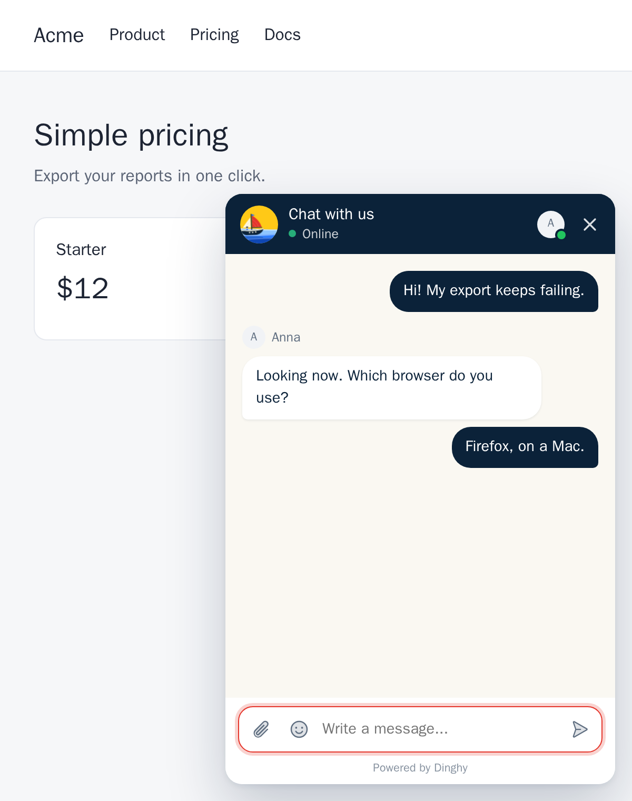

# A live chat widget under 4 KB

One script tag puts a chat button on your site. Visitors write to you, your team answers from a shared inbox. The tag loads with `async`, so it doesn't block your page.

## What your visitors get

A small button in the corner. They click it, type a question, and see your answer in the same window. They can paste or drop a screenshot, or attach a file like a PDF or a log, up to 10 MB. After a refresh the whole conversation is still there. The chat uses English, French or Spanish. It can pick the visitor's language from those three. It can use the visitor's light or dark setting.

If they leave before you answer, they can leave an email. Your reply goes to their inbox, and they can answer from their mail app, right into the same conversation. On a self-hosted install, that needs a mail server, plus an inbound address for [replies by email](/docs/self-hosting#replies-by-email).

On a phone, the open chat fills the screen.



## What your team gets

- One shared inbox for everyone. You see who has each chat and who's replying right now, so you can see when a teammate already has the chat open.
- A push notification on your phone or laptop when someone writes, or an email if your install has a mail server. You don't have to keep a tab open all day.
- Who you're talking to. If they have the chat open right now or when they were last here, their browser and system, and the pages they looked at. If they're signed in to your app, you also see their name, their email and anything else you send, like their plan.
- Search across open and closed conversations, by name, email or anything someone wrote.
- Saved replies you insert with **/**, internal notes that @mention a teammate, labels, and keyboard shortcuts.
- What a visitor types before they send it, and if they read your reply. You can turn the typing preview off.
- A live list and world map of who's on your site now.
- [Analytics](/blog/live-chat-analytics-without-cookies) for conversations, reply times, visits, page views and chat rate.
- [Proactive messages](/blog/proactive-live-chat) from your team, your app or a campaign.
- A soft sound when someone writes in a conversation you don't have open.
- Dinghy has no AI of its own. But your bot can connect through MCP or the API, and its replies wait as drafts until a person sends them. See [Live chat for AI agents](/for/ai-agents).

## It's small

The tag loads a script under 4 KB. The full chat downloads when a visitor opens it, returns to a chat, is identified by your site or has an outbound message to show. The loader also fetches the widget's appearance and sends a small presence request.

The widget lives in its own Shadow DOM. The Shadow DOM keeps the widget's styles separate from your site's.

## It looks like your site

Settings > Appearance changes the look with no code, with a preview next to the form: the colors, the side of the page, a light, dark or automatic theme, the chat button (a boat, a bubble, a label, a square, or hidden), the corners and the words. Your logo is in Settings > Workspace. If you'd rather do it in code, attributes on the tag win over the settings:

```html
<script src="https://chat.example.com/widget/loader.js"
  data-key="wk_your_public_key"
  data-primary="#112233"
  data-accent="#ff5a36"
  async></script>
```

The same page sets the chat's title, the greeting in an empty chat, what it says when nobody's online, and a "Usually replies in" line under the title. Want to open the chat from your own link? Hide the button with `data-launcher="hidden"` and call `Dinghy.open()`. [Add the chat to your site](/docs/add-to-your-site) has every option and event.

## Where it works

Anywhere you can paste a script tag before `</body>`. You can use it with plain HTML, a site builder or a web app. There are step-by-step guides for the common ones:

- [WordPress](/guides/wordpress)
- [Shopify](/guides/shopify)
- [Webflow](/guides/webflow)
- [Next.js](/guides/nextjs)
- [React](/guides/react)
- [Google Tag Manager](/guides/google-tag-manager)
- [All install guides](/guides/)

A coding agent like Claude Code can also add the tag for you and check that it loads. See [the Claude Code guide](/guides/claude-code).

## What it costs

Free if you [run it on your own server](/open-source-live-chat). Or we run it for you on Dinghy Cloud, $9 a month for up to 5 people. [See how that compares](/compare/) with Intercom, Crisp, Tidio and others.
