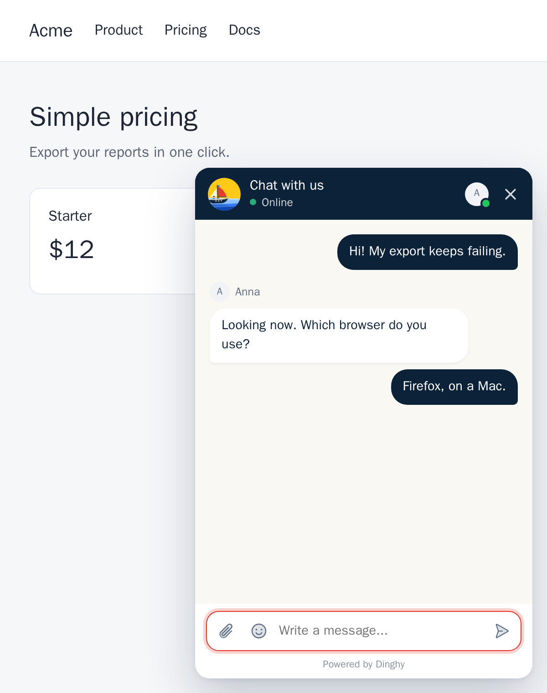

# A live chat widget under 4 KB

One script tag puts a chat button on your site. Visitors write to you, your team answers from a shared inbox, and the tag loads with `async`, so it doesn't block your page.

## What your visitors get

A small button in the corner. They click it, type a question, and see your answer in the same window. They can paste or drop a screenshot, attach a file such as a PDF or a log up to 10 MB, and come back after a refresh to find the whole conversation still there. The chat speaks English, French and Spanish, or the visitor's own language among those, and follows their light or dark setting if you choose.

If they leave before you answer, they can leave an email. Your reply goes to their inbox, and they can answer from their mail app. The answer comes back into the same conversation. On a self-hosted install, that needs a mail server.

On a phone, the open chat fills the screen, so nobody types into a tiny box in the corner.



## What your team gets

- One shared inbox for everyone. You see who has each chat and who is replying right now, so two people don't answer the same customer.
- A push notification on your phone or laptop when someone writes, or an email, if your install has a mail server. No need to keep a tab open all day.
- Who you're talking to. Whether they have the chat open right now or when they were last here, their browser and system, and the pages they looked at. If they're signed in to your app, you also see their name, their email and anything else you send, like their plan.
- Search across open and closed conversations, by name, email or anything someone wrote.
- Saved replies you insert with **/**, internal notes that @mention a teammate, labels, and keyboard shortcuts.
- What a visitor types before they send it, and whether they read your reply. You can turn the typing preview off.
- A live list and world map of who is on your site now.
- An analytics page with conversations per day, how fast you reply and your busiest hours. It's built from the chats you already have, so it tracks nobody.
- A soft sound when someone writes in a conversation you don't have open.
- Optional help from your own AI agent. Dinghy has no AI of its own, but your bot can connect through MCP or the API, and its replies wait as drafts for a person to send. See [Live chat for AI agents](/for/ai-agents).

## It's small

The tag loads a script under 4 KB. The full chat only downloads when a visitor opens it or comes back to a chat, or when your site tells Dinghy who is signed in. A new visitor who never opens it downloads only the loader.

The widget also lives in its own Shadow DOM. Your CSS can't break it, and its CSS can't break your site.

## It looks like your site

Settings > Appearance changes the look with no code, with a preview beside the form: the colors, the side of the page, a light, dark or automatic theme, the chat button (a boat, a bubble, a label, a square, or hidden), the corners, your logo, and the words. Attributes on the tag win over the settings, for a site that wants them in code:

```html
<script src="https://chat.example.com/widget/loader.js"
  data-key="wk_your_public_key"
  data-primary="#112233"
  data-accent="#ff5a36"
  async></script>
```

The same page sets the chat's title, the greeting in an empty chat, what it says when nobody is online, and a "Usually replies in" line under the title. To open the chat from your own link, hide the button with `data-launcher="hidden"` and call `Dinghy.open()`. [Add the chat to your site](/docs/add-to-your-site) has every option and event.

## Where it works

Anywhere you can paste a script tag before `</body>`. That's plain HTML, WordPress, Shopify, Webflow, Next.js, React, Astro, Hugo and any other site where you can add a script. We have step-by-step guides for the common ones:

- [WordPress](/guides/wordpress)
- [Shopify](/guides/shopify)
- [Webflow](/guides/webflow)
- [Next.js](/guides/nextjs)
- [React](/guides/react)
- [Google Tag Manager](/guides/google-tag-manager)
- [All install guides](/guides/)

A coding agent such as Claude Code can also add the tag for you and check that it loads. See [the Claude Code guide](/guides/claude-code).

## What it costs

Free if you [run it on your own server](/open-source-live-chat). Or let us run it on Dinghy Cloud for $7 a month for up to 5 people. [See how that compares](/compare/) with Intercom, Crisp, Tidio and others.
